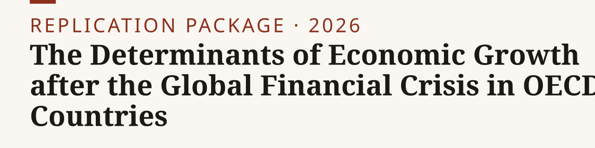
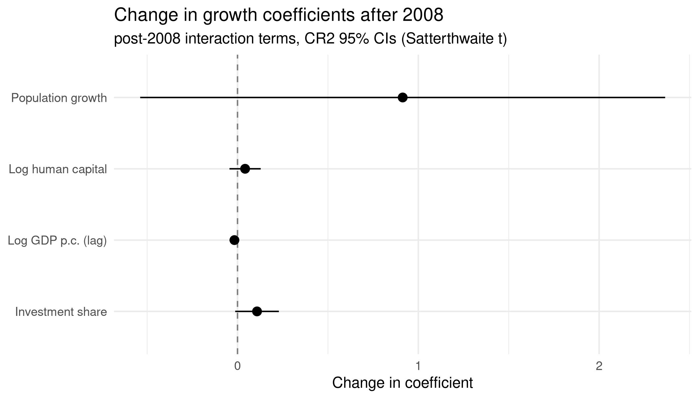

<p><picture><source media="(prefers-color-scheme: dark)" srcset="assets/banner-dark.svg"></picture></p>

**Across 24 OECD economies, 1996 to 2019, the relationships between growth and its structural determinants did not measurably change after the 2008 crisis.**

[Paper](https://nikkhosravipour.com/post/the-determinants-of-economic-growth-after-the-global-financial-crisis-in-oecd-countries) · [Data](#data-availability) · [Site](https://nikkhosravipour.com)

[](LICENSE) [](LICENSE-docs) [](https://www.r-project.org/)

<picture><source media="(prefers-color-scheme: dark)" srcset="05_figures/break_coefficients-dark.png"></picture>

> [!NOTE]
> Bachelor's thesis, WU Vienna, 2026. R 4.2 or newer recommended. Penn World Table 11.0 (downloaded 2026-03-25). Sample: 24 pre-1995 OECD members, 1996 to 2019, balanced panel of 576 observations. Population-growth data vintage is explained under [Data availability](#data-availability).

## Quick start

1. Clone: `git clone https://github.com/nik110403/oecd-growth-thesis.git && cd oecd-growth-thesis`
2. Install packages once: `Rscript 03_code/00_install_packages.R`
3. Run the scripts in order, from the repository root (all paths are relative to it):

```sh
Rscript 03_code/01_load_pwt.R           # filter PWT 11.0 to the 24-country sample
Rscript 03_code/02_load_wdi.R           # reads the pinned raw WDI pull (offline); --live re-pulls from the API
Rscript 03_code/03_construct_variables.R
Rscript 03_code/04_merge_check.R
Rscript 03_code/05_descriptives.R
Rscript 03_code/06_regressions.R        # two-way FE regressions and structural-break tests
Rscript 03_code/07_tables_figures.R
Rscript 03_code/08_diagnostics.R
Rscript 03_code/09_projections.R
```

Figures are written to `05_figures/`, tables to `06_tables/`. Step 02 overwrites `02_data/processed/wdi_popgrowth.rds` with a later WDI vintage; see [Data availability](#data-availability) before running it.

## Method

Annual within-country two-way fixed-effects growth regression on the augmented Solow determinants, with the post-2008 break entering through slope interactions. Standard errors are CR2 cluster-robust with Satterthwaite degrees of freedom (24 clusters); Driscoll-Kraay errors are a secondary check. An unknown-date sup-Wald scan covers break years 2001 to 2015. Details are in `03_code/README.md`.

## Exhibit map

| Exhibit | Script | Output |
|---|---|---|
| Summary statistics | `03_code/05_descriptives.R` | `06_tables/descriptives.md` |
| Pre/post-2008 means | `03_code/05_descriptives.R` | `06_tables/descriptives_prepost.md` |
| Mean growth, pre/post and by-country plots | `03_code/05_descriptives.R` | `05_figures/growth_trend.png`, `growth_prepost.png`, `growth_by_country.png` |
| Growth regressions and post-2008 break | `03_code/07_tables_figures.R` | `06_tables/regressions.md` |
| Robustness checks | `03_code/07_tables_figures.R` | `06_tables/robustness.md` |
| Split-sample estimates | `03_code/07_tables_figures.R` | `06_tables/splitsample.md` |
| Difference GMM | `03_code/07_tables_figures.R` | `06_tables/gmm.md` |
| Sup-Wald break scan | `03_code/07_tables_figures.R` | `06_tables/supwald.md`, `05_figures/supwald_scan.png` |
| Post-2008 coefficient plot (headline figure) | `03_code/07_tables_figures.R` | `05_figures/break_coefficients.png` |
| Panel diagnostics | `03_code/08_diagnostics.R` | `06_tables/diagnostics.txt` |
| Conditional projections | `03_code/09_projections.R` | `05_figures/projections.png`, `05_figures/projection_convergence.png` |

`projections.png` and `projection_convergence.png` are the 2026-06-26 re-render (step 09 also writes the convergence scatter).

## Data availability

| Dataset | Source | Access | Included |
|---|---|---|---|
| Penn World Table 11.0 | Feenstra, Inklaar and Timmer, downloaded 2026-03-25 | Public, CC BY 4.0 | `02_data/raw/pwt110.dta` |
| WDI population growth (SP.POP.GROW) | World Bank, pulled 2026-10-01 (WDI last updated 2026-07-13) | Public, CC BY 4.0 | `02_data/raw/wdi/2026-10-01/` |

Variable provenance is documented in `02_data/documentation/data_sources.md`.

WDI vintage. The thesis results rest on a WDI pull from June 2026 (exact day not recorded), stored in processed form in `02_data/processed/wdi_popgrowth.rds`. The later pull from 2026-10-01 differs in 9 of 600 values (GBR 2013-2019, ITA 2018-2019; maximum absolute difference 0.452 percentage points, ITA 2018 and 2019). WDI is used only as a cross-check (`04_merge_check.R`) and as the `pop_growth_wb` column of `panel_final.csv`. No regression or table depends on it, so the processed file was deliberately not replaced.

Step 02 reads the pinned raw pull offline; `--live` re-pulls the API into a new dated folder. Running step 02 therefore overwrites `wdi_popgrowth.rds` with the 2026-10-01 vintage. To keep the thesis vintage exactly, skip step 02 and run from step 03, or restore the shipped file.

## Repository layout

```text
oecd-growth-thesis/
├── 02_data/
│   ├── raw/             # pwt110.dta; wdi/<date>/ pinned raw WDI pull
│   ├── processed/       # generated .rds and .csv panels and fitted models, shipped so outputs can be inspected without re-running
│   └── documentation/   # data_sources.md (variable provenance)
├── 03_code/             # R pipeline 00 to 09 and a per-script README.md
├── 05_figures/          # generated figures
├── 06_tables/           # generated tables
├── assets/              # banner and social preview (made by tools/banner)
├── tools/banner/        # banner generator
├── CITATION.cff
├── LICENSE
└── LICENSE-docs
```

## Citation

GitHub shows a "Cite this repository" button from `CITATION.cff`. BibTeX:

<details>
<summary>BibTeX</summary>

```bibtex
@thesis{khosravipour2026growth,
  author = {Khosravipour, Nik},
  title  = {The Determinants of Economic Growth after the Global Financial Crisis in {OECD} Countries},
  school = {Vienna University of Economics and Business (WU)},
  type   = {Bachelor's thesis},
  year   = {2026},
  url    = {https://github.com/nik110403/oecd-growth-thesis}
}
```

</details>

## License

Code: [MIT](LICENSE). Text, tables and figures: [CC BY 4.0](LICENSE-docs). Third-party data is not under the MIT licence: PWT 11.0 (Feenstra, Inklaar and Timmer) and World Bank WDI are CC BY 4.0, redistributed with attribution (see `LICENSE-docs`).
